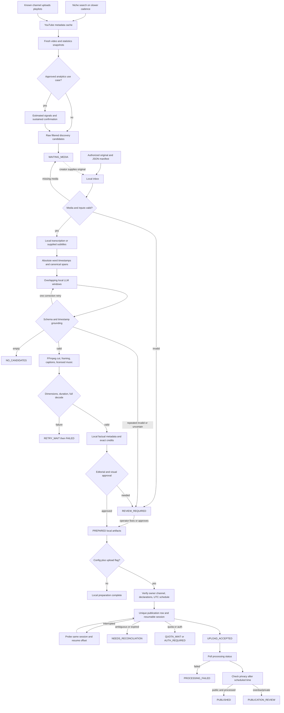

# ClipForge Local

A Python 3.11+ starter that discovers YouTube metadata, accepts authorized original media, transcribes and selects clips locally, renders captioned vertical video, and optionally publishes through owner-authorized YouTube uploads. **The default stops at local preparation.** This is working source code, with synthetic media and mocked network tests; it is not a hosted service.

## License

ClipForge uses the custom **[ClipForge Use-Only License 1.0](LICENSE)**. You may download, install and run the unmodified program for your own personal or business use, including creating monetized videos. Modification of its code or prompts and redistribution require the owner's written permission. Normal configuration, filling in the documented setup examples, and editing your own inputs and outputs are permitted. This is proprietary software with publicly visible source. The license preserves rights required by law and GitHub's terms, including viewing/forking public repositories as those terms permit. [GitHub's explanation](https://docs.github.com/en/repositories/managing-your-repositorys-settings-and-features/customizing-your-repository/licensing-a-repository).

Third-party tools, models and dependencies retain their own licenses; see [THIRD_PARTY_NOTICES.md](THIRD_PARTY_NOTICES.md). The full license controls these permissions.

## Assumptions and costs

One operator, one computer and one intended upload channel. You provide original recordings, creator-delivered originals, or another appropriately authorized media source and verified credits. Discovery does not grant access to media. Initial setup can download open-source software and model weights; subsequent inference uses only local files and loopback Ollama. There are no paid APIs, subscriptions, trial credits or rented GPUs. Electricity, hardware, disk space, bandwidth and your editorial time still cost something.

The CPU baseline is faster-whisper `small` with `int8`, followed sequentially by a quantized `qwen3:4b-instruct` in Ollama. The model's published download is about 2.5 GB and its listed license is Apache 2.0; memory also includes context, runtime, operating system and transcription. Start with roughly 16 GB system RAM as a planning choice, reduce model/context if needed, and benchmark your own machine. An 8 GB system may need a smaller model and more patience. No speed or accuracy is guaranteed. [Model and license](https://ollama.com/library/qwen3:4b-instruct), [Whisper MIT license](https://github.com/openai/whisper/blob/main/LICENSE).

## Stack

| Process | Tool | Requirements |
|---|---|---|
| Discovery/monitoring | YouTube Data API, Requests | API key, available project quota; no media download |
| Manifests/state/cache | Pydantic v2, SQLite, local JSON | Local disk; private state directory |
| Single-machine exclusion | FileLock | One OS account/process lock; not distributed |
| Audio extraction/render/probe | FFmpeg + ffprobe | Build with libx264, AAC and libass; no MoviePy needed |
| Transcription | faster-whisper / CTranslate2 | Downloaded Whisper model; CPU `int8`, optional compatible NVIDIA CUDA |
| Clip selection/metadata | Ollama local structured JSON | Downloaded local GGUF model; cloud disabled on server |
| Captions | Python SRT + ASS, FFmpeg/libass | Suitable installed font, e.g. Arial or DejaVu Sans |
| Music | Local preapproved catalog | Verified license, permitted use, exact attribution |
| Optional upload | google-auth, google-auth-oauthlib, Requests | Channel-owner consent, Desktop OAuth client |
| Scheduling | cron, Windows Task Scheduler or CLI loop | Computer awake, correct account/environment/absolute paths |

## Install

Install Python 3.11 or newer, [FFmpeg](https://ffmpeg.org/download.html) including **ffprobe** and libass, and [Ollama](https://ollama.com/download). Test both executables, and check `ffmpeg -filters` contains `ass`, `sidechaincompress` and `loudnorm`. FFmpeg's licensing depends on the selected build; follow its notices when redistributing binaries. This project does not bundle FFmpeg or model weights.

In this project directory on Windows:

```powershell
py -3.11 -m venv .venv
.\.venv\Scripts\python.exe -m pip install -e ".[ai,youtube,dev]"
.\.venv\Scripts\python.exe -m clipforge init
```

On macOS/Linux:

```sh
python3 -m venv .venv
.venv/bin/python -m pip install -e '.[ai,youtube,dev]'
.venv/bin/python -m clipforge init
```

The minimal `pip install -e .` supports supplied local transcripts, selections and metadata. Extras add inference, Google authentication and tests. Requirements use bounded major versions; freeze a known-working environment after installation (`python -m pip freeze > environment.lock.txt`). The validation environment and exact checks actually run are recorded in [VERIFICATION.md](VERIFICATION.md).

Download the speech model once, before processing private media:

```sh
python -c "from huggingface_hub import snapshot_download; snapshot_download('Systran/faster-whisper-small', local_dir='models/faster-whisper-small')"
```

The CLI requires a local model directory and uses `local_files_only=True`. Set `speech.language` to the actual language (`en` by default), or `null` for detection. For CUDA, set `device: "cuda"` and a supported compute type such as `float16`; install the CUDA/cuDNN combination required by your installed CTranslate2 version. CPU remains supported. [Official faster-whisper setup and options](https://github.com/SYSTRAN/faster-whisper).

Disable Ollama cloud features on the **server**, then restart it. Either merge `{"disable_ollama_cloud":true}` into its `server.json`, or start the server with `OLLAMA_NO_CLOUD=1`. Setting this variable only in the clipping worker does not reconfigure an already-running desktop server. Pull the local model once:

```sh
ollama pull qwen3:4b-instruct
```

The application rejects non-loopback LLM URLs, cloud-tagged models, remote model descriptors, missing local GGUF information and missing local model digests. It disables HTTP environment proxies and redirects for LLM requests. It never invokes hosted AI, web search, or an automatic model pull. Maintain the Ollama server's cloud-disabled setting as a second barrier. [Ollama local-only configuration](https://docs.ollama.com/faq#how-do-i-disable-ollamas-cloud-features), [structured output API](https://docs.ollama.com/capabilities/structured-outputs).

## First run without models or credentials

```sh
python examples/make_demo.py --config config.json
python -m clipforge --config config.json prepare inbox/demo.json
python -m clipforge --config config.json status
```

The demo creates test patterns and tones with **synthetic supplied transcript/selection/metadata fixtures**. Its captions are not a transcription of its tone. It exercises media assembly and state without pretending AI ran. The returned `artifacts` path contains `clip.mp4`, both caption formats, `metadata.json`, `transcript.json`, `render_cache.json` and `artifact.json`.

A generated [synthetic preview](demo/preview.mp4) and its subtitle files are included in `demo/`.

```sh
python -m clipforge inspect prepared/CLIP_ID
python -m clipforge verify prepared/CLIP_ID
```

Replace `CLIP_ID` with the actual returned folder name. Open `clip.mp4` with your normal video player. Keep the synthetic demo out of publication.

## Prepare your recording

1. Put an authorized local recording at `inbox/my-original.mp4`.
2. Copy `examples/source.json` to `inbox/my-original.json` and replace the rights, credit and real editorial-contribution records.
3. Set framing to `center_crop`, `fit` or `blur`. Keep the three approval booleans false until reviewed.
4. Run `python -m clipforge prepare inbox/my-original.json`.

All **configuration and manifest paths resolve relative to `paths.root`**, itself relative to the configuration file. Use absolute paths for unattended schedules. Only source manifest JSON belongs directly in `inbox/`; keep catalog, transcript, selection and metadata files elsewhere. `examples/config.json` shows every setting, without credentials.

`transcript_path` accepts canonical transcript JSON (see the generated fixture) or creator-provided `.srt`. SRT uses real cue timings as phrase units; it cannot supply true per-word alignment. Leave the path null for faster-whisper word timestamps. `candidates_path` and `metadata_path` accept manually reviewed schema-matching JSON, useful for editing or offline tests; null means local LLM. One supplied metadata file applies to each selected clip, so use one clip or provide separate source manifests if titles need individual manual treatment.

For an actually reviewed clip, use:

```sh
python -m clipforge approve prepared/CLIP_ID --metadata-reviewed --visual-reviewed
```

This records your explicit editorial, metadata and framing approval on that artifact. It does not check the truth of a license or guarantee platform acceptance. If a generated metadata file needs correction, edit **`artifact.json`'s metadata** before approval; `metadata.json` is a convenience export. Never mutate a submitted artifact to force an upload retry. The publication snapshot catches input changes and routes them to reconciliation.

## Architecture and states



SQLite stores jobs, artifacts, discovery cache/budgets/observations/signals, reserved slots and publication intentions. Transcription and rendering caches use source checksums and their relevant options. Clip identities include canonical cuts, transcript, source/music checksums, edit/caption/prompt versions, model digest and encoder version. Each intended channel gets a unique publication record. One OS file lock covers each command and the entire loop. To scale beyond one machine, add transactional job claims with leases, compare-and-swap state transitions, shared media storage and worker ownership; a shared lock file alone is insufficient.

## Module 1 — sourcing, observation and authorized media

`sourcing.py` separates discovery from media access. On the slower search cadence it calls `search.list(type=video, order=date, publishedAfter=..., relevanceLanguage=...)` for configured niche terms. For known channel IDs it obtains `contentDetails.relatedPlaylists.uploads` from `channels.list`, then monitors those playlists through `playlistItems.list`. It follows page tokens up to `max_pages`, deduplicates IDs and fetches `videos.list` metadata/statistics in batches of at most 50. Videos missing from a batch response become unavailable and their observations/signals are removed. Filters cover age, duration, declared language and live streams; absent language is routed out for review, because search language is only a relevance hint. The starter conservatively excludes live-stream recordings too.

Successful responses cache briefly. Monitoring and niche-search run times persist independently, so a fast inbox loop does not repeat expensive discovery work. Every attempted API request, including retries/pages, reserves local daily budget before sending. Separate configurable budgets/call costs reflect the currently documented quota buckets; defaults here intentionally stay conservative. Console allocation and other programs sharing that project remain authoritative. More detail and official links: [sourcing policy notes](docs/sourcing-notes.md).

**Custom metrics are disabled by default.** The current additional-analytics rules require eligible audited use cases to obtain explicit approval and accept the applicable policy amendment. A flag or a home-made evidence file grants no permission. Enable calculations only after independently verifying that the approval covers this project, use case and all four metrics; the local evidence gate records that verification and checks its completeness/integrity. It does not authenticate YouTube's approval. Synthetic test observations need no API data. [YouTube derived metrics rules](https://developers.google.com/youtube/terms/derived-metrics-policy).

For an eligible use case the implemented estimates are visible views/subscribers, recent view velocity, velocity lift, and comparison with other videos on the **same channel at similar ages**. With observation times `t0,t1,t2` and views `v0,v1,v2`:

```text
velocity_now    = (v2 - v1) / actual_hours(t2 - t1)
velocity_before = (v1 - v0) / actual_hours(t1 - t0)
velocity_lift   = velocity_now / max(velocity_before, configured_floor)
```

Views divided by video age is a lifetime average speed, not current velocity. Public views do not reveal another channel's actual audience retention. Hidden/missing/zero subscribers suppress ratios; rounded counts label them approximate; the configurable subscriber floor suppresses small-channel exaggeration. Corrected falling view totals reset velocity eligibility, insufficient/too-close snapshots suppress estimates, and unchanged totals flag possible delayed statistics. A baseline uses the median of distinct other videos' closest comparable-age snapshots, with configurable minimum sample count and age tolerance. Separate niche/channel baselines need separate configuration. Default velocity/lift/ratio thresholds are **tuning choices**, with multiple fresh consecutive confirmations required before a trend is promoted. These are estimates, never YouTube metrics or virality probabilities.

Public metadata/snapshots/derived histories expire after 28 days by default (never more than 30). Cached responses retain their original fetch times; cache hits never create fresh observations. Purge runs even if discovery is disabled. Run at least daily, expire backups/log exports too, and purge before reusing stored API data after prolonged downtime. A historical snapshot cannot be "refreshed" by changing its date. `purge` and `forget-discovery` provide deletion paths. [Data storage policy](https://developers.google.com/youtube/terms/developer-policies#e.-handling-youtube-data-and-content).

```sh
# In the scheduler account's environment, set YOUTUBE_API_KEY securely first.
python -m clipforge discover
python -m clipforge purge
python -m clipforge forget-discovery --video-id SOURCE_VIDEO_ID
```

An API key is for discovery; upload requires owner OAuth. Raw discovery candidates wait for authorized originals. Manifests record file path, optional video ID/URL, rights category and reference, exact creator credit, optional local music/attribution, contribution, approval state, declarations and optional schedule. Missing media yields `WAITING_MEDIA`. A written rights reference is an operator assertion to verify, not an automated license check.

The starter deliberately does not use `yt-dlp` or `youtube-transcript-api`. Those tools can technically access some streams/transcripts, but availability varies with account, caption, access and platform constraints. Their technical capability grants no license or API permission. They must not be used as automated workarounds for quotas, access blocks or restrictions. Creator-provided subtitles and local transcription are implemented. `captions.list` lists track metadata, not caption text; authorized `captions.download` requires sufficient video editing permission. That optional OAuth caption-download integration remains unimplemented. [Caption list](https://developers.google.com/youtube/data/reference/rest/v3/captions/list), [caption download](https://developers.google.com/youtube/data/reference/rest/v3/captions/download).

## Module 2 — local transcription and grounded selection

`brain.py` extracts a continuous mono 16 kHz WAV. It never silence-trims or rearranges the source timeline. faster-whisper uses VAD internally and maps timestamps back to original audio; word timestamp accuracy still requires editorial inspection. Word records and compact canonical spans retain absolute source times. The model/generator is consumed, released and garbage-collected before LLM inference, reducing simultaneous memory use. Speech configuration and supplied transcript checksum participate in the transcript cache key.

Long transcripts split into overlapping windows sized conservatively by serialized UTF-8 bytes, prompt/schema overhead and output reserve, within `context_tokens`. Windows retain IDs/times and overlap by up to the maximum editing duration; dense windows can limit that coverage. Raise context or reduce source complexity if a coherent clip cannot fit. Candidate merges suppress overlapping duplicates and rank the surviving set globally to select at most `max_clips`. There is no cross-window timestamp reset.

The **complete prompts** are [selection.txt](clipforge/prompts/selection.txt) and [metadata.txt](clipforge/prompts/metadata.txt). The selection response is exactly `{ "clips": [...] }`, with each clip containing `start_id`, `end_id`, `start_s`, `end_s`, `hook_id`, `payoff_id`, `score`, `reason`, `needs_visual_review`. Schema constraints and application checks reject extra fields, nonfinite values, unknown/window-external IDs, invented times, invalid durations, reversed anchors and out-of-range intervals. A timestamp must equal the canonical boundary exactly. Accepted final times are then read from the canonical transcript, never clamped from a hallucination. One configurable correction retry is allowed; repeated invalid output requires review. An empty list is a valid editorial result.

The default **20–60 seconds** is an editing preference, not a claim about the Shorts maximum. A model score is an editorial estimate, not measured retention. The prompt requires a self-contained hook, useful development, payoff, preserved qualifications/negations and an empty result when appropriate. It treats transcripts as untrusted content and flags dependence on unseen visuals. Schema validation cannot prove preserved meaning; review remains necessary.

## Module 3 — vertical editing, captions and music

`factory.py` uses accurate seek plus re-encoding, not stream-copy cuts. It makes 1080×1920 H.264/AAC, `yuv420p`, fast-start MP4, with configurable CRF/preset/fps. It verifies the exact canonical interval, duration, codecs, dimensions and **full-file decoding** before atomically installing the output. A matching render cache includes encoder version and hashes of video plus both subtitle files. [FFmpeg filters](https://ffmpeg.org/ffmpeg-filters.html).

Center crop fills the frame but removes substantial left/right content from a horizontal recording. Choose `fit` to show the whole source with padding, or `blur` to put the fitted source over a blurred background. Slides, interfaces and demonstrations often require those alternatives and manual framing review. MoviePy adds no value for this continuous FFmpeg workflow; consider it only for more complex compositions whose convenience justifies another layer.

`captions.py` intersects every word/phrase with the selected interval, clamps to its bounds, subtracts source start, groups phrases and wraps readable lines. Thus a word at original `126.0` appears at `126.0 - 125.4 = 0.6` seconds in a clip starting at `125.4`. Both SRT and styled ASS are written; the renderer always burns ASS, while `caption_format` selects the preferred sidecar. ASS declares playback resolution, font, outline and configurable safe-area margin. Literal ASS control characters are displayed safely; text cannot create override tags or executable filters. Subprocess arguments are arrays and subtitle filters reference a fixed safe filename in a private staging directory. Added narration, silence removal or discontinuous editing would require a new explicit timeline map or transcription of the final edited audio; those operations are not implemented.

Music is optional. Prepare a local catalog once: verify permitted uses, commercial/sync/adaptation terms as applicable, save the license evidence, approve the track and preserve its exact attribution. Set `music_catalog` in a source manifest for deterministic selection from approved records; alternatively specify `music_path`, `music_license_reference`, and `music_attribution` directly. The program loops/trims a short track, applies fades and gain reduction, optionally ducks it against source audio, mixes it and applies single-pass loudness normalization. `-16 LUFS` is an adjustable production preference, not a stated YouTube requirement; single-pass normalization is approximate, so use measured two-pass mastering if exact delivery loudness is required. Do not assume "royalty-free" covers every use. No undocumented Audio Library download API is used. [YouTube Audio Library and attribution](https://support.google.com/youtube/answer/3376882?hl=en).

Optional extension, **not implemented**: sample frames with OpenCV/MediaPipe, detect and associate faces across frames, calculate crop coordinates, smooth them, limit pan speed, reset at scene changes and fall back to fit/center crop on failure. Face detection does not identify the active speaker. Interviews need audio/visual speaker association, shot-aware editorial rules, or a stable split layout.

## Module 4 — metadata, publication and recovery

Metadata generation sees the selected excerpt only. Its separate prompt requests supported facts, a natural topic phrase and specific takeaway, excludes invented names/statistics/promises/unrelated trends, and returns title/description/tags. Verified creator credit and music attribution are appended deterministically, verbatim. Newly generated metadata always starts unapproved; JSON validation alone cannot establish factual truth.

For optional publishing, follow [the complete OAuth/upload guide](docs/upload-notes.md). Put the Desktop OAuth JSON in private `secrets/client_secret.json`, set the exact target channel, configure accurate audience/synthetic-media declarations, and authorize once interactively:

```sh
python -m clipforge authorize
```

Google's normal consent browser is part of supported OAuth setup; all recurring work uses scripts/APIs. The token is stored atomically with supported Google libraries for renewal. Restrict `secrets/` and `data/` to your OS user, including SQLite/WAL files and backups. Tokens/session URIs are not printed or committed. This is private-file storage, not a built-in encrypted credential vault. External OAuth Testing can impose refresh-token expiration; revocation/expiry requires reauthorization. The linked guide cites current primary OAuth details.

Owner status records refresh at least every 28 days while enabled; stale remote identifiers/status/session data are deleted after 30 days at the next command, even with uploads disabled. Run regularly and expire backups/exports. To revoke consent and delete local owner API data, run `python -m clipforge revoke`. For local deletion only, use `python -m clipforge delete-owned-data`. These commands preserve only hashed local publication-intention tombstones, preventing erased history from causing automatic reuploads. They do not delete a video from YouTube. Confirm revocation in Google's account permissions if a network failure prevents it. [Current data/revocation policy](https://developers.google.com/youtube/terms/developer-policies).

To enable upload, set `upload.enabled: true`, `target_channel_id`, accurate booleans, and an explicit desired `privacy_status`. Then explicitly pass the upload flag:

```sh
python -m clipforge upload prepared/CLIP_ID --enable-upload
python -m clipforge poll
```

The target channel is verified through owner-authorized `channels.list(mine=true)` before insert. Schedules require a future timezone-aware ISO instant, a configurable lead time, and private status. Set `source_manifest.schedule` on the approved artifact or reserve a daily slot:

```sh
python -m clipforge reserve-slot prepared/CLIP_ID --hour 12
```

The allocator uses `BEGIN IMMEDIATE`, unique channel/time and channel/clip constraints, and reuses the reserved UTC instant on retries. It never moves a stale reservation automatically. Recurring candidates use `America/New_York` by default; ambiguous/nonexistent DST wall-clock slots are skipped. Manual schedules require an explicit offset; autumn 01:30 occurs twice and spring clock jumps skip some times. Daily slot generation at a configured hour is implemented; weekdays, holidays and richer recurring schedules are extensions.

The current Shorts guidance includes videos up to three minutes, with aspect/date/account and Content ID qualifications. The detailed current rules, including music/claim constraints, are linked in [sourcing policy notes](docs/sourcing-notes.md). Vertical rendering or `#Shorts` does not guarantee classification. [Official Shorts guidance](https://support.google.com/youtube/answer/15424877?hl=en).

`upload.py` intentionally uses the documented resumable HTTP protocol with supported Google authentication so session URI and acknowledged byte offset survive process restarts. It commits a unique publication intention before inserting, stores the session before sending media and probes the **existing** session after interruptions or a lost final response. It never invents an idempotency key. Expired/ambiguous sessions require reconciliation, preserving the duplicate guard instead of starting another insert. There is no exactly-once upload guarantee. Safe definite rejections and ambiguous responses have different handling; retries are finite with backoff and separate quota/auth/permanent states. Processing success and actual publication are checked separately after acceptance. [Official resumable protocol](https://developers.google.com/youtube/data/guides/using_resumable_upload_protocol).

Inspect the intended channel in YouTube Studio when reconciliation is required; match file/time/metadata and confirm the actual video ID. Do not delete a publication row to force another upload. Uncertain record repair remains an operator task. Upload acceptance or a successful status poll does not establish complete copyright clearance.

## Unattended operation

Prefer one process per scheduled run, starting at boot/logon and repeating every few minutes. The inbox can run every minute while persisted monitoring/search cadences remain hourly/daily. The CLI loop is also available:

```sh
python -m clipforge --config /absolute/path/config.json loop --interval 60 --discovery
# Add --enable-upload only after all publishing settings and policy are configured.
```

Example cron entry (edit absolute paths and ensure the scheduler account has the discovery key):

```cron
*/5 * * * * /srv/clipforge/.venv/bin/python -m clipforge --config /srv/clipforge/config.json run --discovery
@reboot /srv/clipforge/.venv/bin/python -m clipforge --config /srv/clipforge/config.json run --discovery
```

Use absolute virtual-environment executables; cron may have a minimal PATH and no shell profile. Install the package in that environment; set absolute FFmpeg paths in config if necessary. Do not put credentials into public crontabs or source files. Do not redirect full discovery output into indefinite log archives; API-derived exports must follow retention/deletion rules.

For Windows Task Scheduler create a task under the same user that owns OAuth credentials. Action: your absolute `powershell.exe`/`pwsh.exe`; arguments: `-NoProfile -File "C:\ClipForge\examples\run-once.ps1"`; Start in: `C:\ClipForge`. Edit the wrapper's two absolute paths. Trigger at startup/logon and repeat every five minutes indefinitely; choose **Do not start a new instance**, restart after failure, and enable task history. Do not require an interactive login for routine runs after consent. Expose `YOUTUBE_API_KEY` to that scheduler account, not merely your interactive terminal. A supplied wrapper is an editable example, not an installed task.

Keep the computer awake, plugged in as needed, and with enough free disk. A sleeping/offline computer cannot prepare or upload, although an already processed upload can publish at its reserved time. The worker rotates safe logs at 2 MB × three backups and persists failures in SQLite. `status` makes waiting/review/retry/failed jobs visible; periodically inspect it and Task Scheduler/cron exit results. A lock rejects overlapping runs as `ALREADY_RUNNING`. Failures back off across job attempts; changed inputs reset the attempt count, and an explicit `prepare ... --retry` retries reviewed/fixed work. The loop is single-process; use OS service/scheduler restart facilities after crashes. No separate notification service is included.

## Originality and limits

Copyright permission and monetization eligibility are separate. Cropping, captions, music, borders or logos cannot guarantee avoidance of reused-content findings. The manifest's contribution record describes a verified original demonstration, substantive commentary/analysis, explanation or storytelling already present in your source. This starter assembles that contribution; it does not invent a cosmetic compliance score or automatically add substantive new commentary. Permission, AI checks and editing do not guarantee fair use, monetization, acceptance or virality. [Official monetization/reused-content policy](https://support.google.com/youtube/answer/1311392?hl=en).

## Project layout and implementation boundary

```text
clipforge/
  common.py       strict schemas, configuration, hashes, SQLite and utilities
  sourcing.py     API discovery, caches, budgets, optional approved estimates
  brain.py        local transcription, bounded windows, grounded JSON, metadata
  captions.py     clip-relative SRT/ASS grouping and safe styling
  factory.py      deterministic FFmpeg rendering, music, output verification
  upload.py       owner OAuth, durable resumable transfer and publication polling
  worker.py       CLI, review states, file lock, scheduler, slot allocator
  prompts/        complete selection and metadata system prompts
examples/         full config, manifests, music catalog, demo and schedulers
tests/            offline unit/mocked tests and real synthetic-media tests
docs/             current primary-source policy/permission notes
data/             generated private SQLite, caches and rotated logs (ignored)
inbox/            generated/user-provided media and source manifests (ignored)
prepared/         generated clips and reviewable artifacts (ignored)
secrets/          owner OAuth credentials (ignored)
```

Implemented: the local preparation path, discovery/monitoring, gated trend formulas, caption formats, three framing modes, optional catalog music and ducking, metadata/credits, review states, checksum caches, OS lock, finite job retries, UTC slot reservation, opt-in OAuth/resumable upload and status polling. Tests run offline with real FFmpeg where available.

Optional extensions: face tracking/speaker association, richer slot calendars, two-pass loudness mastering, final-edit narration, automatic substantive editorial augmentation, multi-worker transactional claims and alerts.

Remaining deployment work: install your dependencies/models; configure niche/channel/paths; supply actual rights evidence and media; review model output; prepare a licensed music catalog if desired; perform owner OAuth and set channel/declarations/privacy; obtain any required analytics approval; test on your hardware and account before enabling unattended publishing. Authorized caption downloads and manual upload-record reconciliation are documented integration tasks, not implemented automation.

## Verification

```sh
python -m pytest -q
```

Tests use no real API credentials or inference. FFmpeg tests explicitly skip if the binaries are missing; to point to a portable build set `CLIPFORGE_TEST_FFMPEG` and `CLIPFORGE_TEST_FFPROBE`. Timestamp, subtitle-rebasing, schedule, output/decode/music, repeat-run, and interrupted-upload checks are included. [VERIFICATION.md](VERIFICATION.md) distinguishes executed checks from supplied/unexecuted integrations. Current platform claims were checked against primary documentation on **October 18, 2026**; see the linked notes and recheck before enabling a production account.
